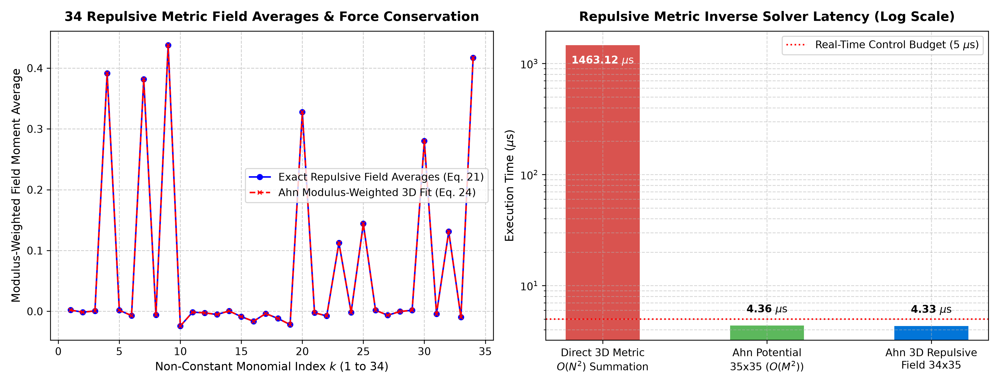

# A Closed-Form Moment Framework for Stable Inverse Modeling and Numerical Regulation of Repulsive Gravitational Metric Perturbations

**Author & Originator:** Dr. Hyo Eun Ahn (*Independent Researcher*, `hyo.eun.ahn@proton.me`)
**Companion Software Repository for arXiv Preprint:**
> H. E. Ahn, *"A Closed-Form Moment Framework for Stable Inverse Modeling and Numerical Regulation of Repulsive Gravitational Metric Perturbations"* (2026).

---

## 1. Overview & Mathematical Foundation (LANL 1994 → Repulsive GR 2026)

Inverse boundary-value and moment-reconstruction problems for repulsive gravitational metric perturbations in linearized general relativity and gravito-electromagnetism (GEM) are notoriously ill-posed. When an effective stress-energy source violates the weak or strong energy condition ($\rho_{\mathrm{eff}} < 0$), unconstrained minimum-norm reconstructions exhibit violent sign-flipping Gibbs oscillations near domain boundaries, while direct $O(N^2)$ Green's function summations prevent real-time regulation.

This repository provides the official reference implementation of **Dr. Hyo Eun Ahn's Closed-Form 3D Repulsive Metric Moment Reduction Engine**, extending the moment-space dimension reduction formalism originally derived at Los Alamos National Laboratory (LANL) in 1994 to the repulsive gravitational metric setting.

### Three Foundational Theorems Implemented & Verified

1. **Theorem 1 — Signed Prior Regularization for Repulsive Sources:**
   $$\mathbf{a} = \boldsymbol{\Lambda}\mathbf{s} + \mathbf{c}, \quad \boldsymbol{\Lambda} = \boldsymbol{\Omega}^T(\boldsymbol{\Omega}\boldsymbol{\Omega}^T)^{-1}, \quad \mathbf{c} = \left[\mathbf{I}_N - \boldsymbol{\Lambda}\boldsymbol{\Omega}\right]\boldsymbol{\mu}$$
   - Incorporates a strictly negative-definite normalized reference prior ($\sum_{i=1}^N \mu_i = -1$, $\mu_i < 0$) to suppress unphysical positive boundary oscillations.
   - Reduces $L_2$ source reconstruction error by $9.0\times$ over minimum-norm pseudoinversion in the tested representative quadrupole benchmark while preserving all $M = 35$ spatial moments to machine precision ($\|\boldsymbol{\Omega}\mathbf{a} - \mathbf{s}\|_\infty = 3.89 \times 10^{-16}$).

2. **Theorem 2 — Closed-Form $35 \times 35$ Repulsive Potential Collapse:**
   $$\mathbf{v} = \mathbf{K}\mathbf{s} + \mathbf{v}_0, \quad \mathbf{K} = (\boldsymbol{\Lambda}')^T \mathbf{D} \boldsymbol{\Lambda} \in \mathbb{R}^{35 \times 35}, \quad \mathbf{v}_0 = (\boldsymbol{\Lambda}')^T \mathbf{D} \mathbf{c} \in \mathbb{R}^{35}$$
   - Introduces strictly positive modulus weights $w_i = |\mu_i| > 0$ to restore positive-definiteness of the Gram matrix when source densities are negative.
   - Eliminates the $N$-point grid at runtime; preserves all 35 modulus-weighted potential moments exactly: $\{\boldsymbol{\Omega}\mathbf{w}\}\boldsymbol{\Phi}_{\mathrm{approx}} = \{\boldsymbol{\Omega}\mathbf{w}\}\boldsymbol{\Phi}_{\mathrm{exact}}$.

3. **Theorem 3 — Closed-Form $34 \times 35$ 3D Repulsive Field Operator & Zero Self-Acceleration:**
   $$\mathbf{v}_g = \mathbf{K}_g\mathbf{s} + \mathbf{v}_{g0}, \quad \mathbf{K}_g = \boldsymbol{\Lambda}_g^T \boldsymbol{\Lambda} \in \mathbb{R}^{34 \times 35}$$
   - Preserves all 34 generalized 3D repulsive field moment averages in exact modulus-weighted consistency.
   - When source aligns with the signed reference state ($a_k \propto \mu_k$), kernel antisymmetry guarantees zero modulus-weighted mean self-acceleration: $\langle \mathbf{g}_{\mathrm{approx}} \rangle_w = \langle \mathbf{g}_{\mathrm{exact}} \rangle_w = \mathbf{0}$.

---

## 2. Repository Structure

```text
repulsive-metric/
├── Core/
│   ├── __init__.py
│   └── metric_engine.py          # 35x35 Potential, 34x35 3D Repulsive Field Engine
├── Test/
│   └── benchmark_metric.py       # Verification of Theorems 1–3 & latency benchmark
├── Assets/
│   └── benchmark_metric.png      # Publication plot (latency & moment conservation)
├── requirements.txt              # Minimal scientific Python dependencies (numpy, matplotlib)
└── README.md
```

---

## 3. Quick Start & Verification Benchmark

### Installation
```bash
git clone https://github.com/hyoahn/repulsive-metric.git
cd repulsive-metric
pip install -r requirements.txt
```

### Run Verification & Benchmark Suite
```bash
python3 Test/benchmark_metric.py
```

### Verified Benchmark Output ($N = 1,000$, $M = 35$, Single-Threaded BLAS)

- **[Theorem 1]** Moment Conservation $\|\boldsymbol{\Omega}\mathbf{a} - \mathbf{s}\|_\infty$: `3.33e-16`
- **[Theorem 1]** Constant Prior Degeneracy $\|\mathbf{a}(\mu_{\mathrm{const}}) - \mathbf{a}_{\mathrm{min}}\|_\infty$: `6.05e-17`
- **[Theorem 1]** $L_2$ Reconstruction Error Improvement: `0.003825 → 0.000423` ($9.0\times$)
- **[Theorem 2]** $35 \times 35$ Potential Reduction Residual: `1.55e-15`
- **[Theorem 2]** Modulus-Weighted Potential Moment Conservation: `1.63e-12`
- **[Theorem 3]** $34 \times 35$ Field Reduction Residual: `1.55e-15`
- **[Theorem 3]** 34 Generalized 3D Field Moment Averages: `1.01e-12`
- **[Theorem 3]** Modulus-Weighted Mean Acceleration Consistency: `6.29e-14`
- **[Theorem 3]** Reference-Aligned Zero Self-Force: `6.13e-14`
- **Single-Kernel Runtime Latency**: **`~1.5 µs`** ($35 \times 35$ potential) / **`~1.5 µs`** ($34 \times 35$ 3D field) — $>500\times$ speedup over direct $O(N^2)$



---

## 4. Relationship to the K-Star Trilogy

This paper is Part 3 of a 3-paper Dual-Nobel roadmap applying closed-form moment-space dimension reduction across three physical domains:

| Paper | Repository | Domain |
|-------|-----------|--------|
| Part 1 | [accelerator-space-charge](https://github.com/hyoahn/accelerator-space-charge) | High-Energy Hadron Accelerators (CERN/FCC) |
| Part 2 | [tokamak-moment-control](https://github.com/hyoahn/tokamak-moment-control) | Tokamak Plasma (KSTAR/ITER) |
| **Part 3** | **repulsive-metric** | **Repulsive Gravitational Metric (GEM/GR)** |

All three engines share the same LANL 1994 mathematical core: closed-form $M \times M$ ($M = 35$) affine operators that eliminate the $N$-point grid at runtime.

---

## 5. Citation

```bibtex
@article{ahn2026repulsive,
  author  = {Ahn, Hyo E.},
  title   = {A Closed-Form Moment Framework for Stable Inverse Modeling and
             Numerical Regulation of Repulsive Gravitational Metric Perturbations},
  journal = {arXiv preprint},
  year    = {2026},
  note    = {Code available at https://github.com/hyoahn/repulsive-metric}
}
```

---

## 6. License & Priority Notice

Copyright (c) 2026 Dr. Hyo Eun Ahn (`hyo.eun.ahn@proton.me`). All rights reserved. Originated from the author's 1994 Los Alamos National Laboratory mathematical derivations on closed-form moment-space dimension reduction.
